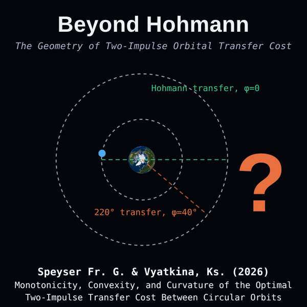

# Two-Impulse Transfer Cost Between Circular Orbits

  <picture>
    <source media="(prefers-color-scheme: dark)" srcset="assets/beyond_hohmann_600x600.gif">
    
  </picture>

**Interactive demonstrator:** [2i-OTCA-C-v1.0-demo/index.html](https://k-f-research.github.io/two-impulse-transfer-cost-circular-orbits/2i-OTCA-C-v1.0-demo/index.html)
-- open this link in a browser to compute transfers interactively, review
the theoretical results, and read the Algorithms documentation, without
installing anything.

This repository accompanies the paper *"Monotonicity, Convexity, and
Curvature of the Optimal Two-Impulse Transfer Cost Between Circular Orbits"*
(part of the 2i-OTC-C Study), archived separately (see `CITATION.cff`). It
contains the mathematical proofs, their corresponding computational
certificates, a reference software implementation
(`2i-OTCA-C-v1.0-algorithm/`), and an interactive demonstrator
(`2i-OTCA-C-v1.0-demo/`) for two-impulse transfers between circular orbits.

See `STATUS.md` for the scientific and reproducibility status of every
theorem, lemma, and conjecture in this repository, including which results
are the article's numbered theorems and which are supplementary results
that are not part of the published manuscript's numbering. The `Numbering
note` section of `STATUS.md` provides the full explanation.

## Structure

- `circular/` -- proofs and computational certificates for two-impulse
  transfers between circular orbits: existence and uniqueness of the
  minimizer, global monotonicity, universal convexity, and the
  curvature/inflection structure (including the still-open extension to
  general R).

  **Note:** Two of this folder's internal theorem labels ("Theorem 1" /
  "Theorem 2" in `hohmann_local_minimum/` and `global_monotonicity/`) are
  swapped relative to the article's numbering. In addition, two other
  folders (`existence_uniqueness_minimizer/` and
  `curvature_sign_change_general_R/`) contain results that are not numbered
  theorems or conjectures in the published article. See `STATUS.md` and
  `docs/mathematical_conventions.md` before citing a folder name as "the
  article's Theorem N."

- `2i-OTCA-C-v1.0-algorithm/` -- **2i-OTCA-C** (*Two-Impulse Orbital
  Transfer Cost Algorithm -- Circular Case*), a software component
  implementing the circular-case cost function, the admissible-angle
  reduction enabled by the proven monotonicity result, and a fast
  closed-form surrogate valid near the Hohmann transfer. Circular case
  only; see its own README for an explicit statement of scope and
  out-of-scope cases.

- `2i-OTCA-C-v1.0-demo/` -- interactive, bilingual (EN/FR) HTML
  demonstrator featuring live solutions, independent geometry/Lambert
  cross-checks, and a Keplerian-speed animation of the transfer arc.

- `docs/mathematical_conventions.md` -- the single source of truth for
  notation throughout the repository.

- `docs/proof_dependencies.md` -- the dependency map between theorems,
  lemmas, and the hypotheses on which they rely.

## Scope

This repository focuses on the analysis and computation of two-impulse, coplanar, impulsive transfers between circular orbits. Within this scope, it provides the mathematical results, certified computational evidence, reference implementations, and software tools developed in the study to evaluate transfer cost and its dependence on the transfer angle.

The models and algorithms are formulated for circular-orbit transfers and therefore cover the corresponding cost, optimization, curvature, and numerical-verification problems within this setting. The present scope excludes elliptical-orbit transfers, orbital-plane changes, perturbations such as J2, finite-duration or finite-thrust propulsion, and mission-level constraints such as launch windows, phasing, and rendezvous.

The software is intended as a research and engineering component that can be integrated into broader mission-analysis workflows. Applications requiring these additional physical models or mission constraints should provide the corresponding modelling and optimization layers separately.

## License

This repository is dual-licensed:

- **Code and software** -- Research, Education and Non-Commercial Use
  License (NCSL-1.0). See `LICENSE-CODE.md`.
- **Theoretical and scientific content** (proofs, paper, Theory tab) --
  Creative Commons Attribution 4.0 International (CC BY 4.0). See
  `LICENSE-CONTENT.md`.

## Citation

See `CITATION.cff`.

Companion paper (the mathematical results themselves):

> Speyser, F. G., & Vyatkina, K. (2026). *Monotonicity, Convexity, and
> Curvature of the Optimal Two-Impulse Transfer Cost Between Circular
> Orbits*. Zenodo.  
> [https://doi.org/10.5281/zenodo.24354529](https://doi.org/10.5281/zenodo.24354529)

Software (the algorithms):

> Speyser, F. G., & Vyatkina, K. (2026). *Two-Impulse Transfer Cost
> Between Circular Orbits* (Version v1.0) [Computer software]. Zenodo.  
> [https://doi.org/10.5281/zenodo.24355454](https://doi.org/10.5281/zenodo.24355453)

---

Copyright (c) 2026 Frederic G. Speyser & Kseniya Vyatkina
