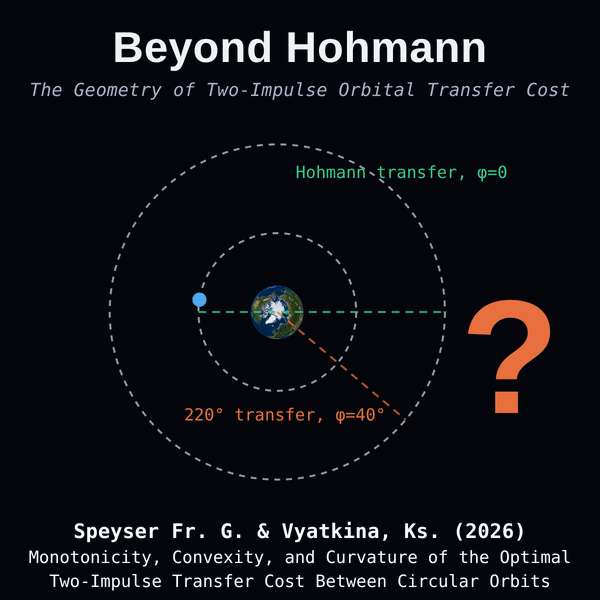

# Monotonicity, Convexity, and Curvature of the Optimal Two-Impulse Transfer Cost Between Circular Orbits

  <picture>
    <source media="(prefers-color-scheme: dark)" srcset="assets/beyond_hohmann_600x600.gif">
    
  </picture>

  
  &nbsp;
  

  <a href="https://k-f-research.github.io/two-impulse-transfer-cost-circular-orbits/2i-OTCA-C-v1.0-demo/index.html"><strong>▶ Launch the interactive demonstrator</strong></a>

This repository accompanies the paper *Monotonicity, Convexity, and Curvature of the Optimal Two-Impulse Transfer Cost Between Circular Orbits*, part of the **2i-OTC-C Study** and archived separately on Zenodo (see [`CITATION.cff`](CITATION.cff)).

It provides the mathematical proofs and their computational certificates, a reference software implementation, and an interactive demonstrator for optimal two-impulse transfers between circular orbits.

For the scientific and reproducibility status of each theorem, lemma, and conjecture—including the distinction between results numbered in the article and supplementary results—see [`STATUS.md`](STATUS.md). The **Numbering note** in that file explains the correspondence in detail.

## Repository contents

- **`circular/`** — Proofs and computational certificates for two-impulse transfers between circular orbits. Topics include existence and uniqueness of the minimizer, global monotonicity, universal convexity, and the curvature/inflection structure, including the still-open extension to general values of \(R\).

  **Theorem-numbering note:** the internal labels “Theorem 1” and “Theorem 2” in `hohmann_local_minimum/` and `global_monotonicity/` are swapped relative to the article's numbering. In addition, `existence_uniqueness_minimizer/` and `curvature_sign_change_general_R/` contain results that are not numbered theorems or conjectures in the published article. Consult [`STATUS.md`](STATUS.md) and [`docs/mathematical_conventions.md`](docs/mathematical_conventions.md) before identifying a folder result as “the article's Theorem N.”

- **`2i-OTCA-C-v1.0-algorithm/`** — **2i-OTCA-C** (*Two-Impulse Orbital Transfer Cost Algorithm — Circular Case*), a software component implementing the circular-case cost function, the admissible-angle reduction enabled by the proven monotonicity result, and a fast closed-form surrogate valid near the Hohmann transfer. Its scope is limited to the circular case; see the directory's README for scope and exclusions.

- **`2i-OTCA-C-v1.0-demo/`** — Interactive, bilingual (English/French) HTML demonstrator featuring live solutions, independent geometry/Lambert cross-checks, and a Keplerian-speed animation of the transfer arc.

- **[`docs/mathematical_conventions.md`](docs/mathematical_conventions.md)** — The repository's reference for notation and mathematical conventions.

- **[`docs/proof_dependencies.md`](docs/proof_dependencies.md)** — Dependency map linking theorems and lemmas to the hypotheses on which they rely.

## Interactive demonstrator

The [2i-OTCA-C v1.0 demonstrator](https://k-f-research.github.io/two-impulse-transfer-cost-circular-orbits/2i-OTCA-C-v1.0-demo/index.html) runs in a modern web browser. It requires no installation and allows users to explore transfer solutions, review the theoretical results, and consult the Algorithms documentation.

## Scope and limitations

This repository studies and computes **two-impulse, coplanar, impulsive transfers between circular orbits**. Within that setting, it addresses the transfer cost, its optimization, its curvature properties, and associated numerical-verification questions.

The models and algorithms are specifically formulated for circular-orbit transfers. They do **not** currently model elliptical-orbit transfers, orbital-plane changes, perturbations such as \(J_2\), finite-duration or finite-thrust propulsion, or mission-level constraints such as launch windows, phasing, and rendezvous.

The software is intended as a research and engineering component that may be integrated into broader mission-analysis workflows. Applications involving the excluded effects or constraints must provide the corresponding physical models and optimization layers separately.

## Licensing

This repository contains two distinct categories of material, each governed by its own license. Please read the applicable license before using, modifying, or redistributing any material.

### Code and software — NCSL-1.0

The software, including the demonstrator, the `2i-OTCA-C` library, and the relevant code in `circular/`, is released under the **Research, Education and Non-Commercial Use License (NCSL-1.0)**. Subject to its terms, non-commercial research, education, personal study, use, modification, and redistribution are permitted.

Any **Commercial Purpose** use requires prior written authorization. The license defines this term broadly; it expressly includes research performed for, or funded by, a commercial entity, and is not limited to direct resale. The full license text is authoritative; this summary is provided for convenience only.

### Theoretical and scientific content — CC BY 4.0

The mathematical results, proofs, and written scientific exposition are released under the **Creative Commons Attribution 4.0 International (CC BY 4.0)** license. They may be shared and adapted, including for commercial purposes, provided appropriate attribution is given and the license terms are followed.

### Commercial-use rights management

**PREYSSE SAS manages requests for commercial use of the software on behalf of the authors. PREYSSE SAS is not the copyright owner by virtue of this management role.** Commercial-use requests must be addressed to PREYSSE SAS or another person or entity duly authorized by the relevant rights holders. Please obtain written authorization before any commercial-purpose use of the software.

**PREYSSE SAS**  
Aérodrome de Châteauneuf-sur-Cher  
100, route de l'aérodrome — Bât. D  
18190 Serruelles — France  
[www.preysse.fr](https://www.preysse.fr/) · SIREN: 939 503 983

The license files and their complete terms prevail over this summary in the event of any discrepancy.

## Citation

Please cite the companion paper when referring to the mathematical results, and cite the software when it materially supports a publication.

**Companion paper — mathematical results**  
Speyser, F. G., & Vyatkina, K. (2026). *Monotonicity, Convexity, and Curvature of the Optimal Two-Impulse Transfer Cost Between Circular Orbits*. Zenodo.  
[https://doi.org/10.5281/zenodo.24354529](https://doi.org/10.5281/zenodo.24354529)

**Software — algorithm**  
Speyser, F. G., & Vyatkina, K. (2026). *Two-Impulse Transfer Cost Between Circular Orbits* (Version v1.0) [Computer software]. Zenodo.  
[https://doi.org/10.5281/zenodo.24355454](https://doi.org/10.5281/zenodo.24355454)

## Contact

For scientific questions, contact the authors: `f.speyser (at) ik.me` · `k.speyser (at) ik.me`.

For commercial-use enquiries concerning the software, contact [PREYSSE SAS](https://www.preysse.fr/).

---

Copyright © 2026 Frédéric G. Speyser and Kseniya Vyatkina. Commercial-use rights for the software are managed by PREYSSE SAS on behalf of the authors.

