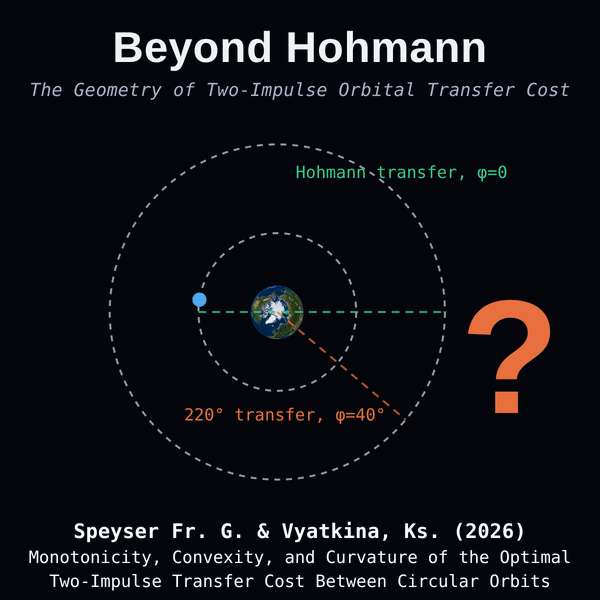

# Monotonie, convexité et courbure du coût optimal d'un transfert à deux impulsions entre orbites circulaires

  <picture>
    <source media="(prefers-color-scheme: dark)" srcset="assets/beyond_hohmann_600x600.gif">
    
  </picture>

  
  &nbsp;
  

  <a href="https://k-f-research.github.io/two-impulse-transfer-cost-circular-orbits/2i-OTCA-C-v1.0-demo/index.html"><strong>▶ Ouvrir le démonstrateur interactif</strong></a>

Ce dépôt accompagne l'article *Monotonicity, Convexity, and Curvature of the Optimal Two-Impulse Transfer Cost Between Circular Orbits*, qui fait partie de l'étude **2i-OTC-C** et est archivé séparément sur Zenodo (voir [`CITATION.cff`](CITATION.cff)).

Il rassemble les démonstrations mathématiques et leurs certificats computationnels, une implémentation logicielle de référence ainsi qu'un démonstrateur interactif consacrés aux transferts optimaux à deux impulsions entre orbites circulaires.

Le fichier [`STATUS.md`](STATUS.md) présente l'état scientifique et reproductible de chaque théorème, lemme et conjecture. Il distingue notamment les résultats numérotés dans l'article des résultats complémentaires qui ne font pas partie de sa numérotation. La section **Numbering note** de ce fichier précise cette correspondance.

## Contenu du dépôt

- **`circular/`** — Démonstrations et certificats computationnels relatifs aux transferts à deux impulsions entre orbites circulaires : existence et unicité du minimiseur, monotonie globale, convexité universelle et structure de courbure et d'inflexion, y compris l'extension encore ouverte au cas général en \(R\).

  **Note sur la numérotation des théorèmes :** les intitulés internes « Theorem 1 » et « Theorem 2 » des dossiers `hohmann_local_minimum/` et `global_monotonicity/` sont inversés par rapport à la numérotation de l'article. Par ailleurs, les dossiers `existence_uniqueness_minimizer/` et `curvature_sign_change_general_R/` contiennent des résultats qui ne sont pas présentés comme des théorèmes ou conjectures numérotés dans l'article publié. Avant de désigner un résultat comme « le théorème N de l'article », veuillez consulter [`STATUS.md`](STATUS.md) et [`docs/mathematical_conventions.md`](docs/mathematical_conventions.md).

- **`2i-OTCA-C-v1.0-algorithm/`** — **2i-OTCA-C** (*Two-Impulse Orbital Transfer Cost Algorithm — Circular Case*), composant logiciel qui implémente la fonction de coût dans le cas circulaire, la réduction du domaine des angles admissibles rendue possible par le résultat démontré de monotonie, ainsi qu'une approximation rapide sous forme fermée, valable au voisinage du transfert de Hohmann. Son périmètre est limité au cas circulaire ; le README du dossier précise son champ d'application et ses exclusions.

- **`2i-OTCA-C-v1.0-demo/`** — Démonstrateur HTML interactif bilingue (français/anglais), proposant des solutions calculées en direct, des vérifications indépendantes par la géométrie et la méthode de Lambert, ainsi qu'une animation de l'arc de transfert à vitesse képlérienne.

- **[`docs/mathematical_conventions.md`](docs/mathematical_conventions.md)** — Référence commune aux notations et conventions mathématiques du dépôt.

- **[`docs/proof_dependencies.md`](docs/proof_dependencies.md)** — Carte des dépendances entre théorèmes, lemmes et hypothèses utilisées.

## Démonstrateur interactif

Le [démonstrateur 2i-OTCA-C v1.0](https://k-f-research.github.io/two-impulse-transfer-cost-circular-orbits/2i-OTCA-C-v1.0-demo/index.html) s'utilise directement dans un navigateur récent, sans installation. Il permet d'explorer les solutions de transfert, de consulter les résultats théoriques et de parcourir la documentation des algorithmes.

## Périmètre et limites

Ce dépôt porte sur l'étude et le calcul des **transferts impulsifs, coplanaires, à deux impulsions entre orbites circulaires**. Dans ce cadre, il traite du coût de transfert, de son optimisation, de ses propriétés de courbure et des questions de vérification numérique associées.

Les modèles et algorithmes sont spécifiquement formulés pour les transferts entre orbites circulaires. Ils ne couvrent **pas**, à ce stade, les transferts entre orbites elliptiques, les changements de plan orbital, les perturbations telles que \(J_2\), la propulsion à poussée finie ou de durée finie, ni les contraintes propres à la conception de mission telles que les fenêtres de lancement, le phasage et le rendez-vous orbital.

Le logiciel est conçu comme un composant de recherche et d'ingénierie pouvant être intégré à des chaînes plus larges d'analyse de mission. Les applications faisant intervenir les phénomènes ou contraintes exclus doivent intégrer séparément les modèles physiques et les couches d'optimisation correspondants.

## Licences et droits d'utilisation

Le dépôt comprend deux catégories de contenus distinctes, régies par deux licences différentes. Veuillez consulter la licence applicable avant toute utilisation, modification ou redistribution.

### Code et logiciel — NCSL-1.0

Le logiciel, comprenant le démonstrateur, la bibliothèque `2i-OTCA-C` et le code concerné du dossier `circular/`, est mis à disposition sous la **Research, Education and Non-Commercial Use License (NCSL-1.0)**. Sous réserve de ses conditions, l'utilisation, l'étude, l'exécution, la copie, la modification et la redistribution à des fins non commerciales sont autorisées.

Tout usage à une **Fin Commerciale** nécessite une autorisation écrite préalable. La licence définit cette notion de manière large : elle inclut expressément les travaux de recherche réalisés pour le compte d'une entité commerciale ou financés par celle-ci, et ne se limite donc pas à la revente directe. Le texte intégral de la licence fait foi ; le présent résumé est fourni à titre informatif.

### Contenu théorique et scientifique — CC BY 4.0

Les résultats mathématiques, les démonstrations et l'exposé scientifique écrit sont mis à disposition sous licence **Creative Commons Attribution 4.0 International (CC BY 4.0)**. Ils peuvent être partagés et adaptés, y compris à des fins commerciales, sous réserve de respecter les conditions de la licence et de citer les auteurs de manière appropriée.

### Gestion des droits d'usage commercial

**La société PREYSSE SAS assure, pour le compte des auteurs, la gestion des demandes relatives à l'usage commercial du logiciel. PREYSSE SAS intervient en qualité de gestionnaire des droits ; elle n'est pas titulaire du droit d'auteur du seul fait de ce rôle.** Les demandes d'usage commercial doivent être adressées à PREYSSE SAS ou à toute autre personne ou entité dûment habilitée par les titulaires des droits concernés. Une autorisation écrite doit être obtenue avant tout usage du logiciel à une fin commerciale.

**PREYSSE SAS**  
Aérodrome de Châteauneuf-sur-Cher  
100, route de l'aérodrome — Bât. D  
18190 Serruelles — France  
[www.preysse.fr](https://www.preysse.fr/) · SIREN : 939 503 983

En cas de divergence, les fichiers de licence et leurs textes intégraux prévalent sur ce résumé.

## Références bibliographiques

Veuillez citer l'article compagnon lorsque vous faites référence aux résultats mathématiques, et citer le logiciel lorsqu'il contribue de manière substantielle à une publication.

**Article compagnon — résultats mathématiques**  
Speyser, F. G., & Vyatkina, K. (2026). *Monotonicity, Convexity, and Curvature of the Optimal Two-Impulse Transfer Cost Between Circular Orbits*. Zenodo.  
[https://doi.org/10.5281/zenodo.24354529](https://doi.org/10.5281/zenodo.24354529)

**Logiciel — algorithme**  
Speyser, F. G., & Vyatkina, K. (2026). *Two-Impulse Transfer Cost Between Circular Orbits* (Version v1.0) [Logiciel]. Zenodo.  
[https://doi.org/10.5281/zenodo.24355454](https://doi.org/10.5281/zenodo.24355454)

## Contact

Pour les questions scientifiques : `f.speyser (at) ik.me` · `k.speyser (at) ik.me`.

Pour toute demande relative à l'usage commercial du logiciel : [PREYSSE SAS](https://www.preysse.fr/).

---

Copyright © 2026 Frédéric G. Speyser et Kseniya Vyatkina. La gestion des droits d'usage commercial du logiciel est assurée par PREYSSE SAS pour le compte des auteurs.

